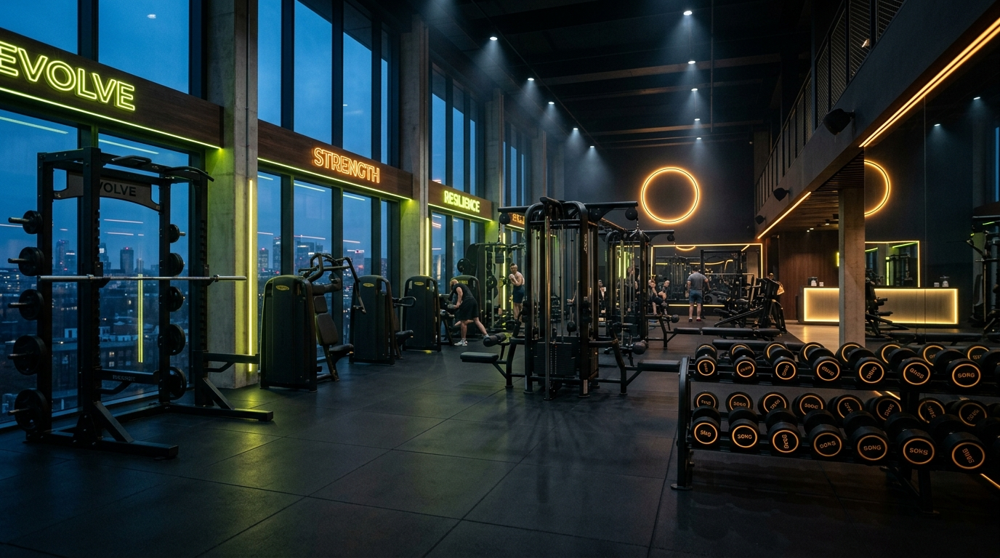

# ⚡ IRON PULSE ATHLETICS // Luxury High-Performance Gym & Athletic Club



**Iron Pulse Athletics** is an ultra-modern, responsive, high-performance website engineered for elite fitness facilities, boutique bodybuilding gyms, and athletic training clubs. Built with pure semantic HTML5, modern vanilla CSS3 design systems, and vanilla JavaScript logic.

---

## 🌟 Key Features

- **⚡ High-Impact Athletic Visual Design:**
  - Dark luxury carbon theme with electric volt lime (`#ccff00`) and molten blaze accents.
  - Glassmorphic card surfaces (`backdrop-filter: blur(16px)`), subtle ambient gradients, and smooth hover micro-animations.
  - Live animated facility capacity indicator and stats counter.

- **📅 Interactive Weekly Class Timetable & Reservation System:**
  - Day selector tabs (Monday through Sunday) with instant slot availability counters.
  - Interactive spot booking modal with instant confirmation and seat allocation.

- **🏋️‍♂️ Smart Workout Split Generator:**
  - Tailors customized weekly workout routines based on fitness goals (Hypertrophy, Strength, Fat Loss Shred, Hybrid Endurance) and training frequency (3, 4, 5, or 6 Days).
  - Generates detailed day-by-day splits with prescribed exercises, sets, reps, and targets.
  - One-click `.txt` workout plan download.

- **🥗 Biometric BMI & Daily Calorie / Macro Target Calculator:**
  - Interactive range sliders for Height and Weight with real-time responsive updates.
  - Calculates BMI score, weight category badge, Total Daily Energy Expenditure (TDEE).
  - Computes optimal macronutrient distribution (Protein, Carbohydrates, Fats) with visual progress bars.

- **💳 Transparent Membership Pricing Matrix:**
  - Interactive billing toggle between Monthly and Annual plans with automated 20% discount recalculation.

- **🎟️ Instant 7-Day VIP Guest Pass Generator:**
  - Generates an authentic digital pass card with a randomized pass ID, expiration date, member details, and barcode.

- **🎵 Built-in Synthesizer Workout Beats (Web Audio API):**
  - Synthesizes 128 BPM energetic workout rhythm with kick drum, hi-hat, and synth bass chords directly in the browser—zero external audio dependencies!
  - Animated audio equalizer bars synced to playback.

---

## 🚀 Getting Started

No build step or Node packages required! Simply clone and open `index.html` in any modern web browser or serve it with any static server:

```bash
# Clone the repository
git clone https://github.com/404existential/iron-pulse-gym.git

# Open directory
cd iron-pulse-gym

# Open in browser (Windows)
start index.html

# Or run with Python local server
python -m http.server 3000
```

---

## 📂 Project Architecture

```
iron-pulse-gym/
├── index.html           # Semantic structure & SEO-optimized markup
├── styles.css           # Custom CSS design system, typography & animations
├── app.js               # Interactive calculators, timetable, synthesizer & modals
├── README.md            # Project documentation & GitHub overview
└── assets/
    └── images/
        ├── hero.jpg             # High-res gym interior
        ├── trainer-alex.jpg     # Coach Alex Rivera
        └── trainer-elena.jpg    # Coach Elena Rostova
```

---

## 🛠️ Built With

- **HTML5:** Semantic architecture, accessible forms, OpenGraph meta tags.
- **Vanilla CSS3:** Custom properties (CSS variables), CSS Grid & Flexbox, Glassmorphism.
- **Vanilla JavaScript (ES6+):** Web Audio API, IntersectionObserver, dynamic DOM manipulation.
- **Google Fonts:** Syne & Outfit.

---

## 📄 License

MIT License. Designed & Developed for **Iron Pulse Athletics Club**.
